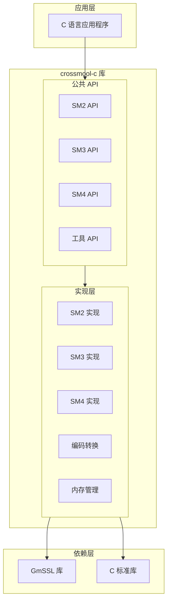
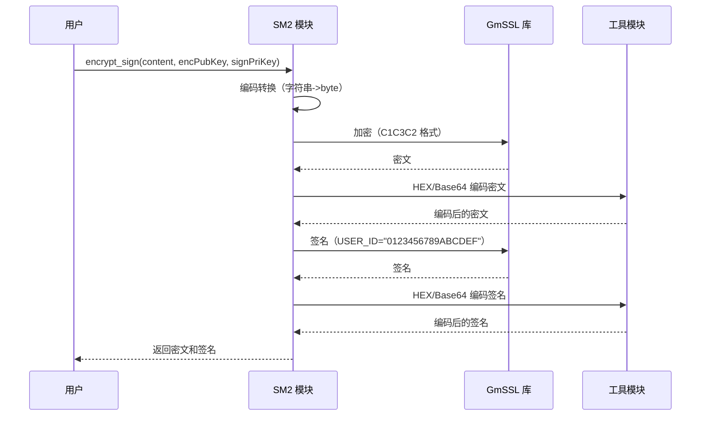
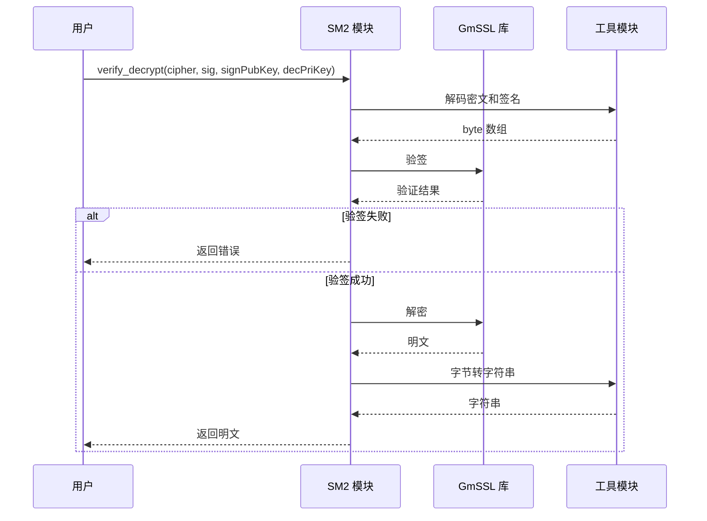
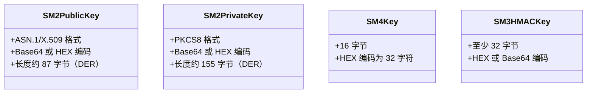

# C 语言国密工具库 (crossmool-c) 技术设计文档

## 1. 概述

### 1.1 系统总结
本设计文档描述基于 GmSSL 库开发的 C 语言国密算法工具库的技术实现方案。该库提供 SM2、SM3、SM4 三种国密算法的实用工具方法，与 Java 版本保持完全互通。

### 1.2 目的与价值
- 提供原生 C 语言的国密算法实现
- 支持多平台编译（Windows/Linux/macOS）
- 与 crossmool 多语言版本保持互通性
- 易于集成到现有 C 语言项目

### 1.3 目标用户与使用场景
- **目标用户**：C 语言开发者、嵌入式系统开发者
- **使用场景**：安全通信、数据加密、数字签名、身份认证

### 1.4 关键技术与架构方法
- **底层依赖**：GmSSL 库（通过 vcpkg 管理）
- **构建工具**：CMake + vcpkg
- **编码标准**：C20 标准
- **设计模式**：过程式编程 + 模块化设计

## 2. 技术架构

### 2.1 整体架构（C4 组件图）



### 2.2 目录结构

```
c/crossmool/
├── CMakeLists.txt              # CMake 构建配置
├── vcpkg.json                  # vcpkg 依赖配置
├── README.md                   # 项目说明文档
├── include/                    # 公共头文件
│   ├── crossmool.h            # 主头文件
│   ├── crossmool_sm2.h        # SM2 API 声明
│   ├── crossmool_sm3.h        # SM3 API 声明
│   ├── crossmool_sm4.h        # SM4 API 声明
│   ├── crossmool_util.h       # 工具函数声明
│   └── crossmool_error.h      # 错误码定义
├── src/                        # 源代码
│   ├── sm2.c                   # SM2 实现
│   ├── sm3.c                   # SM3 实现
│   ├── sm4.c                   # SM4 实现
│   ├── util_base64.c           # Base64 编码
│   ├── util_hex.c              # HEX 编码
│   ├── util_string.c           # 字符串处理
│   └── error.c                 # 错误处理
├── tests/                      # 测试代码
│   ├── test_sm2.c              # SM2 测试
│   ├── test_sm3.c              # SM3 测试
│   ├── test_sm4.c              # SM4 测试
│   └── test_interop.c          # 互通性测试
└── examples/                   # 示例代码
    ├── example_sm2.c           # SM2 使用示例
    ├── example_sm3.c           # SM3 使用示例
    └── example_sm4.c           # SM4 使用示例
```

### 2.3 关键技术选型

| 类别 | 技术 | 说明 |
|------|------|------|
| 编程语言 | C20 | 支持最新 C 语言特性 |
| 构建工具 | CMake 3.20+ | 跨平台构建系统 |
| 包管理器 | vcpkg | 依赖管理 |
| 加密库 | GmSSL 2.x | 国密算法实现 |
| 编译器 | GCC 7.0+/Clang 10.0+/MSVC 2019+ | 三大主流编译器 |
| 测试框架 | CMocka | C 语言单元测试 |

## 3. 业务实现

### 3.1 模块职责

#### 3.1.1 SM2 模块
- 密钥对生成（ASN.1/X.509 格式）
- 数据加密（C1C3C2 格式）
- 数据解密
- 数字签名
- 签名验证

#### 3.1.2 SM3 模块
- 数据杂凑
- HMAC-SM3
- HMAC 验证

#### 3.1.3 SM4 模块
- 密钥生成
- ECB 模式加密
- ECB 模式解密

#### 3.1.4 工具模块
- Base64 编解码
- HEX 编解码
- 字符串编码转换
- 格式检测

### 3.2 API 接口设计

#### 3.2.1 错误码定义（crossmool_error.h）

```c
#ifndef CROSSMOOL_ERROR_H
#define CROSSMOOL_ERROR_H

#ifdef __cplusplus
extern "C" {
#endif

// 成功状态码
#define CROSSMOOL_SUCCESS  0

// 错误状态码
#define CROSSMOOL_ERR_INVALID_PARAM     -1  // 参数错误
#define CROSSMOOL_ERR_MEMORY_ALLOC      -2  // 内存分配失败
#define CROSSMOOL_ERR_ENCRYPT_DECRYPT   -3  // 加密/解密失败
#define CROSSMOOL_ERR_SIGN_VERIFY       -4  // 签名/验签失败
#define CROSSMOOL_ERR_FORMAT_CONVERSION -5  // 格式转换错误
#define CROSSMOOL_ERR_KEY_INVALID       -6  // 密钥无效
#define CROSSMOOL_ERR_CHARSET_INVALID   -7  // 字符集不支持

/**
 * 获取错误描述字符串
 * @param error_code 错误码
 * @return 错误描述字符串（静态字符串，无需释放）
 */
const char* crossmool_error_string(int error_code);

/**
 * 获取库版本号
 * @return 版本号字符串（格式：major.minor.patch）
 */
const char* crossmool_version(void);

#ifdef __cplusplus
}
#endif

#endif // CROSSMOOL_ERROR_H
```

#### 3.2.2 SM2 API（crossmool_sm2.h）

```c
#ifndef CROSSMOOL_SM2_H
#define CROSSMOOL_SM2_H

#include "crossmool_error.h"
#include <stddef.h>

#ifdef __cplusplus
extern "C" {
#endif

// SM2 密钥对结构
typedef struct {
    char* public_key;   // Base64 或 HEX 编码的公钥
    char* private_key;  // Base64 或 HEX 编码的私钥
} crossmool_sm2_keypair_t;

// 密文签名对结构
typedef struct {
    char* ciphertext;   // 密文
    char* signature;    // 签名
} crossmool_sm2_cipher_sig_pair_t;

/**
 * 生成 SM2 密钥对（Base64 编码）
 * @param keypair 输出参数，存储生成的密钥对
 * @return 成功返回 0，失败返回负数错误码
 * @note 调用者需调用 crossmool_sm2_keypair_free() 释放内存
 */
int crossmool_sm2_generate_keypair_base64(crossmool_sm2_keypair_t* keypair);

/**
 * 生成 SM2 密钥对（HEX 编码）
 * @param keypair 输出参数，存储生成的密钥对
 * @return 成功返回 0，失败返回负数错误码
 */
int crossmool_sm2_generate_keypair_hex(crossmool_sm2_keypair_t* keypair);

/**
 * 释放密钥对内存
 * @param keypair 要释放的密钥对
 */
void crossmool_sm2_keypair_free(crossmool_sm2_keypair_t* keypair);

/**
 * SM2 加密（返回 byte 数组）
 * @param content 明文数据
 * @param content_len 明文长度
 * @param public_key 公钥（支持 Base64 或 HEX 字符串）
 * @param ciphertext 输出参数，存储密文
 * @param ciphertext_len 输出参数，存储密文长度
 * @return 成功返回 0，失败返回负数错误码
 * @note 调用者需调用 free() 释放 ciphertext 内存
 */
int crossmool_sm2_encrypt(
    const unsigned char* content,
    size_t content_len,
    const char* public_key,
    unsigned char** ciphertext,
    size_t* ciphertext_len
);

/**
 * SM2 加密（返回 HEX 字符串）
 * @param content 明文数据
 * @param content_len 明文长度
 * @param charset 字符集（如"UTF-8"、"GBK"）
 * @param public_key 公钥（支持 Base64 或 HEX 字符串）
 * @param ciphertext_hex 输出参数，存储 HEX 编码的密文
 * @return 成功返回 0，失败返回负数错误码
 * @note 调用者需调用 free() 释放 ciphertext_hex 内存
 */
int crossmool_sm2_encrypt_to_hex(
    const unsigned char* content,
    size_t content_len,
    const char* charset,
    const char* public_key,
    char** ciphertext_hex
);

/**
 * SM2 加密（返回 Base64 字符串）
 * @param content 明文数据
 * @param content_len 明文长度
 * @param charset 字符集
 * @param public_key 公钥
 * @param ciphertext_base64 输出参数，存储 Base64 编码的密文
 * @return 成功返回 0，失败返回负数错误码
 */
int crossmool_sm2_encrypt_to_base64(
    const unsigned char* content,
    size_t content_len,
    const char* charset,
    const char* public_key,
    char** ciphertext_base64
);

/**
 * SM2 解密（返回 byte 数组）
 * @param ciphertext 密文数据（支持 HEX 或 Base64 字符串）
 * @param private_key 私钥（支持 Base64 或 HEX 字符串）
 * @param plaintext 输出参数，存储明文
 * @param plaintext_len 输出参数，存储明文长度
 * @return 成功返回 0，失败返回负数错误码
 * @note 调用者需调用 free() 释放 plaintext 内存
 */
int crossmool_sm2_decrypt(
    const char* ciphertext,
    const char* private_key,
    unsigned char** plaintext,
    size_t* plaintext_len
);

/**
 * SM2 解密并转换为字符串
 * @param ciphertext 密文数据（支持 HEX 或 Base64 字符串）
 * @param private_key 私钥
 * @param charset 字符集
 * @param plaintext_str 输出参数，存储明文字符串
 * @return 成功返回 0，失败返回负数错误码
 * @note 调用者需调用 free() 释放 plaintext_str 内存
 */
int crossmool_sm2_decrypt_to_string(
    const char* ciphertext,
    const char* private_key,
    const char* charset,
    char** plaintext_str
);

/**
 * SM2 签名（返回 byte 数组）
 * @param content 待签名数据
 * @param content_len 数据长度
 * @param private_key 私钥
 * @param signature 输出参数，存储签名
 * @param signature_len 输出参数，存储签名长度（应为 64）
 * @return 成功返回 0，失败返回负数错误码
 * @note 调用者需调用 free() 释放 signature 内存
 */
int crossmool_sm2_sign(
    const unsigned char* content,
    size_t content_len,
    const char* private_key,
    unsigned char** signature,
    size_t* signature_len
);

/**
 * SM2 签名（返回 HEX 字符串）
 * @param content 待签名数据
 * @param content_len 数据长度
 * @param charset 字符集
 * @param private_key 私钥
 * @param signature_hex 输出参数，存储 HEX 编码的签名
 * @return 成功返回 0，失败返回负数错误码
 */
int crossmool_sm2_sign_to_hex(
    const unsigned char* content,
    size_t content_len,
    const char* charset,
    const char* private_key,
    char** signature_hex
);

/**
 * SM2 签名（返回 Base64 字符串）
 * @param content 待签名数据
 * @param content_len 数据长度
 * @param charset 字符集
 * @param private_key 私钥
 * @param signature_base64 输出参数，存储 Base64 编码的签名
 * @return 成功返回 0，失败返回负数错误码
 */
int crossmool_sm2_sign_to_base64(
    const unsigned char* content,
    size_t content_len,
    const char* charset,
    const char* private_key,
    char** signature_base64
);

/**
 * SM2 验签
 * @param content 原始数据
 * @param content_len 数据长度
 * @param signature 签名数据（支持 HEX 或 Base64 字符串）
 * @param public_key 公钥
 * @return 验证成功返回 1，失败返回 0，错误返回负数
 */
int crossmool_sm2_verify(
    const unsigned char* content,
    size_t content_len,
    const char* signature,
    const char* public_key
);

/**
 * 加密并签名
 * @param content 明文数据
 * @param content_len 数据长度
 * @param charset 字符集
 * @param enc_public_key 加密用公钥
 * @param sign_private_key 签名用私钥
 * @param to_base64 是否使用 Base64 编码（0=HEX, 1=Base64）
 * @param result 输出参数，存储密文和签名
 * @return 成功返回 0，失败返回负数错误码
 * @note 调用者需调用 crossmool_sm2_cipher_sig_pair_free() 释放内存
 */
int crossmool_sm2_encrypt_sign(
    const unsigned char* content,
    size_t content_len,
    const char* charset,
    const char* enc_public_key,
    const char* sign_private_key,
    int to_base64,
    crossmool_sm2_cipher_sig_pair_t* result
);

/**
 * 验签并解密
 * @param ciphertext 密文（与 encrypt_sign 相同的编码格式）
 * @param signature 签名（与 encrypt_sign 相同的编码格式）
 * @param sign_public_key 验签用公钥
 * @param dec_private_key 解密用私钥
 * @param charset 字符集
 * @param plaintext 输出参数，存储解密后的明文
 * @return 成功返回 0，失败返回负数错误码
 * @note 调用者需调用 free() 释放 plaintext 内存
 */
int crossmool_sm2_verify_decrypt(
    const char* ciphertext,
    const char* signature,
    const char* sign_public_key,
    const char* dec_private_key,
    const char* charset,
    char** plaintext
);

/**
 * 释放密文签名对内存
 * @param pair 要释放的密文签名对
 */
void crossmool_sm2_cipher_sig_pair_free(crossmool_sm2_cipher_sig_pair_t* pair);

#ifdef __cplusplus
}
#endif

#endif // CROSSMOOL_SM2_H
```

#### 3.2.3 SM3 API（crossmool_sm3.h）

```c
#ifndef CROSSMOOL_SM3_H
#define CROSSMOOL_SM3_H

#include "crossmool_error.h"
#include <stddef.h>

#ifdef __cplusplus
extern "C" {
#endif

#define CROSSMOOL_SM3_DIGEST_SIZE 32  // SM3 杂凑值长度（32 字节）

/**
 * SM3 杂凑（返回 byte 数组）
 * @param data 输入数据
 * @param data_len 数据长度
 * @param digest 输出参数，存储杂凑值（至少 32 字节）
 * @return 成功返回 0，失败返回负数错误码
 */
int crossmool_sm3_digest(
    const unsigned char* data,
    size_t data_len,
    unsigned char* digest
);

/**
 * SM3 杂凑（返回 HEX 字符串）
 * @param data 输入数据
 * @param data_len 数据长度
 * @param digest_hex 输出参数，存储 HEX 编码的杂凑值
 * @return 成功返回 0，失败返回负数错误码
 * @note 调用者需调用 free() 释放 digest_hex 内存
 */
int crossmool_sm3_digest_to_hex(
    const unsigned char* data,
    size_t data_len,
    char** digest_hex
);

/**
 * SM3 杂凑（返回 Base64 字符串）
 * @param data 输入数据
 * @param data_len 数据长度
 * @param digest_base64 输出参数，存储 Base64 编码的杂凑值
 * @return 成功返回 0，失败返回负数错误码
 */
int crossmool_sm3_digest_to_base64(
    const unsigned char* data,
    size_t data_len,
    char** digest_base64
);

/**
 * 生成 HMAC-SM3 密钥
 * @param key_length 密钥长度（字节，至少 32）
 * @param key 输出参数，存储生成的密钥
 * @return 成功返回 0，失败返回负数错误码
 * @note 调用者需调用 free() 释放 key 内存
 */
int crossmool_sm3_generate_hmac_key(
    size_t key_length,
    unsigned char** key
);

/**
 * HMAC-SM3（返回 byte 数组）
 * @param key HMAC 密钥
 * @param key_len 密钥长度
 * @param data 输入数据
 * @param data_len 数据长度
 * @param mac 输出参数，存储 HMAC 值（至少 32 字节）
 * @return 成功返回 0，失败返回负数错误码
 */
int crossmool_sm3_hmac(
    const unsigned char* key,
    size_t key_len,
    const unsigned char* data,
    size_t data_len,
    unsigned char* mac
);

/**
 * HMAC-SM3（返回 HEX 字符串）
 * @param key HMAC 密钥（支持 HEX 或 Base64 字符串）
 * @param data 输入数据（支持 HEX、Base64 或 UTF-8 字符串）
 * @param mac_hex 输出参数，存储 HEX 编码的 HMAC 值
 * @return 成功返回 0，失败返回负数错误码
 */
int crossmool_sm3_hmac_to_hex(
    const char* key,
    const char* data,
    char** mac_hex
);

/**
 * HMAC-SM3（返回 Base64 字符串）
 * @param key HMAC 密钥
 * @param data 输入数据
 * @param mac_base64 输出参数，存储 Base64 编码的 HMAC 值
 * @return 成功返回 0，失败返回负数错误码
 */
int crossmool_sm3_hmac_to_base64(
    const char* key,
    const char* data,
    char** mac_base64
);

/**
 * 验证 HMAC-SM3
 * @param key HMAC 密钥
 * @param data 输入数据
 * @param received_mac 接收到的 HMAC 值
 * @return 验证成功返回 1，失败返回 0，错误返回负数
 */
int crossmool_sm3_hmac_verify(
    const char* key,
    const char* data,
    const char* received_mac
);

#ifdef __cplusplus
}
#endif

#endif // CROSSMOOL_SM3_H
```

#### 3.2.4 SM4 API（crossmool_sm4.h）

```c
#ifndef CROSSMOOL_SM4_H
#define CROSSMOOL_SM4_H

#include "crossmool_error.h"
#include <stddef.h>

#ifdef __cplusplus
extern "C" {
#endif

#define CROSSMOOL_SM4_KEY_SIZE 16  // SM4 密钥长度（16 字节）

/**
 * 生成 SM4 密钥
 * @param key 输出参数，存储生成的密钥（至少 16 字节）
 * @return 成功返回 0，失败返回负数错误码
 */
int crossmool_sm4_generate_key(unsigned char* key);

/**
 * 生成 SM4 密钥（返回 HEX 字符串）
 * @param key_hex 输出参数，存储 HEX 编码的密钥
 * @return 成功返回 0，失败返回负数错误码
 * @note 调用者需调用 free() 释放 key_hex 内存
 */
int crossmool_sm4_generate_key_hex(char** key_hex);

/**
 * 解析 HEX 密钥字符串
 * @param hex_key HEX 编码的密钥字符串
 * @param key 输出参数，存储解析后的密钥（至少 16 字节）
 * @return 成功返回 0，失败返回负数错误码
 */
int crossmool_sm4_parse_hex_key(const char* hex_key, unsigned char* key);

/**
 * SM4 ECB 模式加密（返回 HEX 字符串）
 * @param key 密钥（16 字节）
 * @param plaintext 明文数据
 * @param plaintext_len 明文长度
 * @param ciphertext_hex 输出参数，存储 HEX 编码的密文
 * @return 成功返回 0，失败返回负数错误码
 * @note 调用者需调用 free() 释放 ciphertext_hex 内存
 */
int crossmool_sm4_encrypt_ecb(
    const unsigned char* key,
    const unsigned char* plaintext,
    size_t plaintext_len,
    char** ciphertext_hex
);

/**
 * SM4 ECB 模式解密
 * @param key 密钥（16 字节）
 * @param ciphertext_hex HEX 编码的密文
 * @param plaintext 输出参数，存储解密后的明文
 * @param plaintext_len 输出参数，存储明文长度
 * @return 成功返回 0，失败返回负数错误码
 * @note 调用者需调用 free() 释放 plaintext 内存
 */
int crossmool_sm4_decrypt_ecb(
    const unsigned char* key,
    const char* ciphertext_hex,
    unsigned char** plaintext,
    size_t* plaintext_len
);

#ifdef __cplusplus
}
#endif

#endif // CROSSMOOL_SM4_H
```

#### 3.2.5 工具函数 API（crossmool_util.h）

```c
#ifndef CROSSMOOL_UTIL_H
#define CROSSMOOL_UTIL_H

#include "crossmool_error.h"
#include <stddef.h>

#ifdef __cplusplus
extern "C" {
#endif

/**
 * 判断字符串是否为 HEX 格式
 * @param str 输入字符串
 * @return 是 HEX 格式返回 1，否则返回 0
 */
int crossmool_is_hex_string(const char* str);

/**
 * 判断字符串是否为 Base64 格式
 * @param str 输入字符串
 * @return 是 Base64 格式返回 1，否则返回 0
 */
int crossmool_is_base64_string(const char* str);

/**
 * HEX 编码
 * @param data 输入数据
 * @param data_len 数据长度
 * @param hex_str 输出参数，存储 HEX 编码字符串
 * @return 成功返回 0，失败返回负数错误码
 * @note 调用者需调用 free() 释放 hex_str 内存
 */
int crossmool_hex_encode(const unsigned char* data, size_t data_len, char** hex_str);

/**
 * HEX 解码
 * @param hex_str HEX 编码字符串
 * @param data 输出参数，存储解码后的数据
 * @param data_len 输出参数，存储数据长度
 * @return 成功返回 0，失败返回负数错误码
 * @note 调用者需调用 free() 释放 data 内存
 */
int crossmool_hex_decode(const char* hex_str, unsigned char** data, size_t* data_len);

/**
 * Base64 编码
 * @param data 输入数据
 * @param data_len 数据长度
 * @param base64_str 输出参数，存储 Base64 编码字符串
 * @return 成功返回 0，失败返回负数错误码
 * @note 调用者需调用 free() 释放 base64_str 内存
 */
int crossmool_base64_encode(const unsigned char* data, size_t data_len, char** base64_str);

/**
 * Base64 解码
 * @param base64_str Base64 编码字符串
 * @param data 输出参数，存储解码后的数据
 * @param data_len 输出参数，存储数据长度
 * @return 成功返回 0，失败返回负数错误码
 * @note 调用者需调用 free() 释放 data 内存
 */
int crossmool_base64_decode(const char* base64_str, unsigned char** data, size_t* data_len);

/**
 * 字符串转字节数组（支持字符集）
 * @param str 输入字符串
 * @param charset 字符集（如"UTF-8"、"GBK"）
 * @param data 输出参数，存储字节数组
 * @param data_len 输出参数，存储字节长度
 * @return 成功返回 0，失败返回负数错误码
 * @note 调用者需调用 free() 释放 data 内存
 */
int crossmool_string_to_bytes(
    const char* str,
    const char* charset,
    unsigned char** data,
    size_t* data_len
);

/**
 * 字节数组转字符串（支持字符集）
 * @param data 字节数组
 * @param data_len 字节长度
 * @param charset 字符集
 * @param str 输出参数，存储字符串
 * @return 成功返回 0，失败返回负数错误码
 * @note 调用者需调用 free() 释放 str 内存
 */
int crossmool_bytes_to_string(
    const unsigned char* data,
    size_t data_len,
    const char* charset,
    char** str
);

/**
 * 清理全局资源（可选调用）
 */
void crossmool_cleanup(void);

#ifdef __cplusplus
}
#endif

#endif // CROSSMOOL_UTIL_H
```

### 3.3 业务流程图

#### 3.3.1 SM2 加密签名流程



#### 3.3.2 SM2 验签解密流程



### 3.4 数据模型

#### 3.4.1 密钥格式



## 4. 数据设计

### 4.1 数据结构

```c
// SM2 密文格式（C1C3C2）
// C1: 65 字节（椭圆曲线点）
// C3: 32 字节（SM3 杂凑值）
// C2: 可变长度（加密数据）
// 总长度 = 65 + 32 + C2 长度 = 97 + 明文长度

// SM2 签名格式
// r: 32 字节
// s: 32 字节
// 总长度 = 64 字节

// SM3 杂凑值
// 固定 32 字节

// SM4 密文
// 块大小：16 字节
// 总长度：明文长度向上取整到 16 的倍数（PKCS7 填充）
```

### 4.2 内存管理策略

1. **动态内存分配**：所有返回的字符串和字节数组都需要调用者手动释放
2. **错误处理**：发生错误时自动释放已分配的临时内存
3. **内存清零**：敏感数据（如密钥）使用后立即清零

## 5. 错误处理

### 5.1 错误分类

| 错误码 | 含义 | 处理建议 |
|--------|------|----------|
| 0 | 成功 | - |
| -1 | 参数错误 | 检查输入参数是否有效 |
| -2 | 内存分配失败 | 检查系统内存状态 |
| -3 | 加密/解密失败 | 检查密钥和密文格式 |
| -4 | 签名/验签失败 | 检查签名数据和密钥 |
| -5 | 格式转换错误 | 检查编码格式 |
| -6 | 密钥无效 | 重新生成或验证密钥 |
| -7 | 字符集不支持 | 使用支持的字符集 |

### 5.2 错误处理模式

```c
// 典型错误处理模式
int result = crossmool_sm2_encrypt_sign(...);
if (result != CROSSMOOL_SUCCESS) {
    fprintf(stderr, "Error: %s\n", crossmool_error_string(result));
    // 清理已分配的资源
    crossmool_sm2_cipher_sig_pair_free(&result_pair);
    return -1;
}
```

## 6. 测试策略

### 6.1 单元测试

- **SM2 测试**：密钥生成、加密解密、签名验签
- **SM3 测试**：杂凑计算、HMAC
- **SM4 测试**：密钥生成、加密解密
- **工具函数测试**：编解码、格式检测

### 6.2 互通性测试

- 与 Java 版本进行密钥格式互通测试
- 加密/解密互通测试
- 签名/验签互通测试

### 6.3 性能测试

- 大数据量加密/解密性能
- 批量签名/验签性能

## 7. 安全考虑

### 7.1 密钥保护

- 使用 `mlock()` 锁定敏感内存
- 密钥使用后立即清零
- 避免密钥出现在日志中

### 7.2 输入验证

- 所有输入参数进行 NULL 检查
- 密钥格式严格验证
- 数据长度边界检查

### 7.3 安全编码

- 使用安全的字符串函数（如 `strncpy` 代替 `strcpy`）
- 防止缓冲区溢出
- 避免格式化字符串漏洞