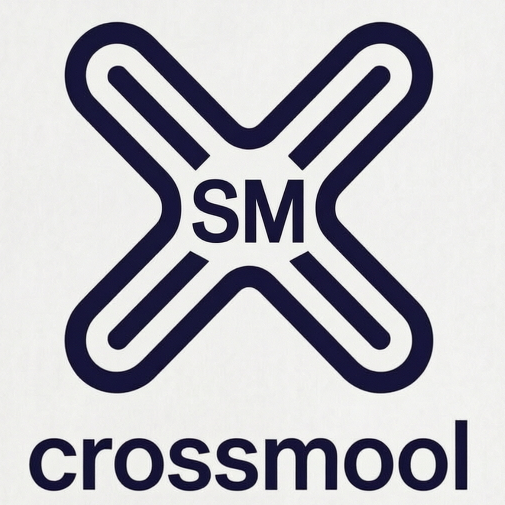

# crossmool

#### 介绍
crossmool是一个SM2/SM3/SM4的工具集，命名取自 cross sm tool，即cross [s]m [t]ool，它的作用有2个：
1.方便用户（即应用软件开发人员）直接使用，省去了用户基于基础函数库自己进行封装的时间；
2.支持跨编程语言互通，即用A语言加密的，可以使用B语言进行解密，这在实际生产活动中是一个非常劳累的活动，需要耗费大量精力和时间（因为，各种加密算法有各种模式mode、编码方式encode、默认传参、格式等，只要有一点配置不一致，就无法互通）。
总之就是：拿来主义，用户拿来就傻瓜式使用，不用自己去做各种封装和选择。
The crossmool is the short name of cross-[platform]-sm-tool-[kit]. It wanna provide the common tools for cross-languages-sm-encryption.
The first plan is to support Java, Python, JavaScript, Golang, Rust, C++, C, C#.

####Milestone
20260622 finish the Java, Python, Rust, Golang compile.
20260623 finish the C compile and build.
20260701 finished the build & test for the 8 languages.

#### 安装教程

1.  C & CPP(C++) just support the MSVC right now. (Stay tuned for GCC & Clang.)
2.  CSharp(C#) support the .net8 or upper.
3.  Java supports JDK21.
4.  Golang supports 1.24.0.
5.  Python requires 3.8.0 or upper.
6.  JavaScript requires nodejs-22 or upper.
7.  Rust supports 1.95.0 or upper.

#### 使用说明

Please read the /userdoc/public_function_split_by_functions.md

#### 参与贡献
just accepts issues & suggestions. (It means does not accept CODE right now, because It will change the LICENSE in the future.)

#### License
LGPL-v3 
（在初期阶段，为了减少碎片化的可能性，这个软件使用了LGPL-v3协议。我们的目标是将来切换为Apache协议）
(To reduce the probability of fragmentation issues, this software will use the LGPL-v3 license in its early stages. And the goal is to switch to the Apache License in the future.)
